  

## Opa! Eu sou o Bruno Custódio 👋

- 🔬 **Agora:** IA aplicada ao Direito, com RAG, LLMs e classificação de documentos
- 🧠 **Estudando:** machine learning, visão computacional e engenharia de LLMs
- 🛠️ **Projetos:** [TrucoHub](https://github.com/BrunoGTB/TrucoHub) · [reconhecedor de humor](https://github.com/BrunoGTB/reconhecedor-de-humor) (expressões faciais com MediaPipe + scikit-learn)
- 🐧 **Setup:** Arch Linux + Hyprland
- 💬 **Fale comigo sobre:** IA, Linux, jogos de cartas e projetos open source

### 🧰 Tecnologias

  &nbsp;
  &nbsp;
  &nbsp;
  &nbsp;
  &nbsp;
  &nbsp;
  &nbsp;
  &nbsp;
  &nbsp;
  &nbsp;
  &nbsp;
  

### 📊 Estatísticas

  
  

### 📫 Contato

  
  
  
  

<picture>
  <source media="(prefers-color-scheme: dark)" srcset="https://raw.githubusercontent.com/BrunoGTB/BrunoGTB/output/github-contribution-grid-snake-dark.svg">
  
</picture>
